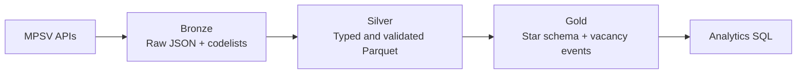

# Czech Job Market Data Pipeline

[](https://github.com/tmajerech/czech-job-market-pipeline/actions/workflows/ci.yml)

Portfolio data-engineering pipeline built from official Czech MPSV job-market
data with Python, DuckDB, and Parquet. It runs locally; no AWS deployment is
required or included.



- Bronze preserves daily source snapshots and all referenced codelists.
- Silver validates schemas, grains, and references before publishing Parquet.
- Gold publishes dimensions, facts, bridges, and `NEW`/`REMOVED` events.

```bash
cd local
python3 -m venv .venv
.venv/bin/pip install -r requirements.txt
.venv/bin/python build_bronze.py &&
.venv/bin/python build_silver.py &&
.venv/bin/python build_gold.py
.venv/bin/python -m pytest
```

See the [implemented data model](docs/data-model.md) and
[local pipeline operations](docs/local-pipeline-operations.md). Downloaded source
snapshots are ignored by Git because they can contain personal contact data.
