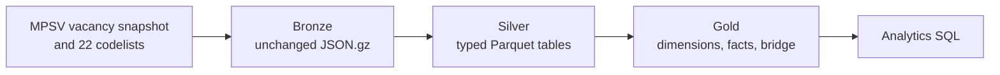
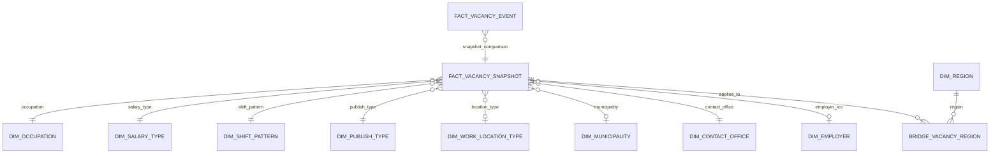

# Implemented data model

This document describes the data model currently produced by the local
pipeline. It is an implementation contract, not a proposal for a future
warehouse.

## Layer overview



Every layer is partitioned by `snapshot_date`. Source identifiers retain their
MPSV namespaces, such as `CzIsco/52231`, rather than being replaced with
generated surrogate keys.

## Bronze

Bronze preserves the downloaded source files without transforming their
payloads:

```text
local/s3_doppelganger/bronze/mpsv/
├── volna-mista/snapshot_date=YYYY-MM-DD/volna-mista.json.gz
└── codelists/snapshot_date=YYYY-MM-DD/<codelist>.json.gz
```

One run downloads the complete current vacancy snapshot and all 22 codelists.
Downloads use a temporary file followed by an atomic rename, and an existing
non-empty file is reused. Full vacancy snapshots can contain contact-person PII
and therefore remain ignored by Git.

## Silver

Silver converts one Bronze snapshot into typed, validated Parquet tables. The
grain always includes `snapshot_date`, so identifiers from different daily
snapshots are never mixed.

### Vacancy tables

| Table | Grain | Content |
|---|---|---|
| `vacancies` | `(snapshot_date, portal_id)` | Source vacancy ID, lifecycle dates, salary and position measures, analytical flags, employer and codelist references, location fields, and selected repeated IDs stored as typed lists |
| `vacancy_workplaces` | `(snapshot_date, portal_id, workplace_name)` | Structured workplace address and municipality, district, and region references |
| `vacancy_benefits` | `(snapshot_date, portal_id, benefit_id)` | Benefit identifier and source description |
| `vacancy_required_skills` | `(snapshot_date, portal_id, skill_id)` | Required skill identifier and description |
| `vacancy_required_language` | `(snapshot_date, portal_id, language_id, skill_level_id)` | Required language, required level, and description |

The `vacancies` table currently keeps employment relationship IDs, workplace
suitability IDs, and required education IDs as list columns. They are not
published as separate bridge tables in V1.

### Reference tables

| Table | Grain | Content |
|---|---|---|
| `occupations` | `(snapshot_date, occupation_id)` | CZ-ISCO code, Czech name, hierarchy level, and derived parent occupation ID |
| `regions` | `(snapshot_date, region_id)` | Source code, Czech name, and NUTS 3 code |
| `districts` | `(snapshot_date, district_id)` | Source code, name, LAU code, and region reference |
| `municipalities` | `(snapshot_date, municipality_id)` | Source code, name, and district reference |
| `salary_types` | `(snapshot_date, salary_type_id)` | Salary-type code and name |
| `shift_patterns` | `(snapshot_date, shift_pattern_id)` | Shift-pattern code and name |
| `publish_types` | `(snapshot_date, publish_type_id)` | Publication-mode code and name |
| `work_location_types` | `(snapshot_date, work_location_type_id)` | Work-location-type code and name |
| `contact_offices` | `(snapshot_date, contact_office_id)` | Labour Office code and name |

### PII boundary

`vacancy_contacts` is created and validated at
`(snapshot_date, portal_id)` grain so source-shape failures are visible, but it
has `publish = False`. Names, personal emails, and phone numbers therefore do
not appear in published Silver or Gold Parquet files.

## Gold

Gold exposes the analytical model used by the queries under
`local/analytics/queries/`.



All dimension relationships are scoped by `snapshot_date` in addition to the
displayed business key.

### Facts and bridge

| Table | Grain | Purpose |
|---|---|---|
| `fact_vacancy_snapshot` | `(snapshot_date, portal_id)` | One row per vacancy present in a daily snapshot, with measures, lifecycle dates, dimension references, analytical flags, `region_count`, and `location_scope` |
| `fact_vacancy_event` | `(snapshot_date, portal_id)` | `NEW` and `REMOVED` events derived by comparing the current fact snapshot with the closest earlier completed Gold snapshot |
| `bridge_vacancy_region` | `(snapshot_date, portal_id, region_id)` | Deduplicated many-to-many relationship between vacancies and explicitly resolvable regions |

`fact_vacancy_event` is absent for the first Gold snapshot because no earlier
snapshot exists. It does not publish a `CHANGED` event: attribute changes remain
observable by comparing the two snapshot facts. Rebuilding a historical Gold
snapshot also refreshes the event partition of the closest later snapshot.

The regional bridge resolves regions from structured workplaces, a direct
municipality, or district lists. Nationwide vacancies are deliberately excluded
instead of being copied into all 14 regions. Vacancies with no resolvable region
also remain outside the bridge.

`fact_vacancy_snapshot.location_scope` has four values:

- `nationwide`: the source explicitly applies the vacancy to the whole country;
- `single_region`: exactly one bridge relationship exists;
- `multi_region`: more than one bridge relationship exists;
- `unresolved`: no region could be resolved and the vacancy is not nationwide.

### Dimensions

| Table | Grain | Purpose |
|---|---|---|
| `dim_occupation` | `(snapshot_date, occupation_id)` | Snapshot-specific CZ-ISCO hierarchy |
| `dim_region` | `(snapshot_date, region_id)` | Region description and NUTS 3 code |
| `dim_municipality` | `(snapshot_date, municipality_id)` | Municipality flattened with its district and region hierarchy |
| `dim_salary_type` | `(snapshot_date, salary_type_id)` | Monthly/hourly salary-type description |
| `dim_shift_pattern` | `(snapshot_date, shift_pattern_id)` | Work-schedule description |
| `dim_publish_type` | `(snapshot_date, publish_type_id)` | Vacancy publication mode |
| `dim_work_location_type` | `(snapshot_date, work_location_type_id)` | Source work-location classification |
| `dim_contact_office` | `(snapshot_date, contact_office_id)` | Labour Office contact-office description |
| `dim_employer` | `(snapshot_date, employer_ico)` | Disclosed employers identified only by non-null IČO |

`dim_employer` does not create name-based or unknown employer members. When one
IČO has several observed names in a snapshot, the vacancy with the latest
`updated_at` supplies the name; `portal_id` is the deterministic tie-breaker.
Facts without IČO keep a null employer reference.

## Validation and publication contract

Before publication, every Silver and Gold table must pass the shared grain
checks:

- every grain column is non-null;
- no duplicate grain exists;
- exported Parquet row count matches the validated DuckDB table.

Additional checks enforce required Bronze columns, reject unexpected source
columns, validate municipality/district/region relationships, preserve fact row
counts, and require fact references to resolve to the matching snapshot-specific
dimensions. Optional references are checked whenever they are present.

All tables for one Silver or Gold snapshot are validated and written to a
same-filesystem staging directory before final files are replaced. Publication
uses `_INCOMPLETE` and `_SUCCESS` snapshot markers; readers reject an incomplete
snapshot. The local implementation is intentionally single-writer.

## Supported analytics

The implemented model directly supports:

- vacancy and offered-position counts by captured date;
- vacancy measures by occupation, region, municipality, employer, salary type,
  shift pattern, publication mode, work-location type, and contact office;
- regional demand by occupation through `bridge_vacancy_region`;
- new, removed, and net vacancy counts between completed snapshots.

## Deliberate V1 limits

- The pipeline uses complete vacancy snapshots as its source of truth; official
  increment feeds are not processed.
- Unemployment datasets are not part of the implemented Bronze, Silver, or Gold
  model.
- The model does not assert business-valid Type 2 history. Its history is the
  sequence of snapshots captured by this project.
- Prior occupations are not published, and several repeated source attributes
  remain typed lists in `vacancies` rather than separate bridges.
- Salary values retain their declared monthly/hourly types and are not
  normalized across salary types.
- Concurrent publishers are unsupported; run one local build process at a time.
